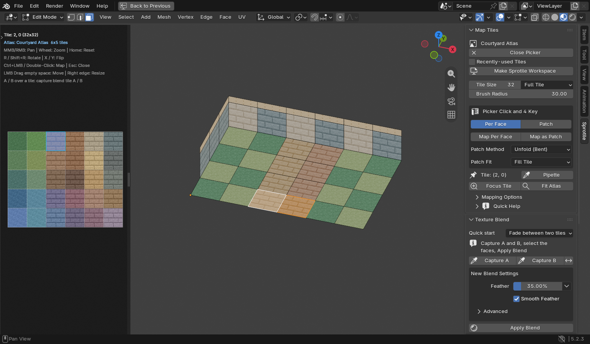
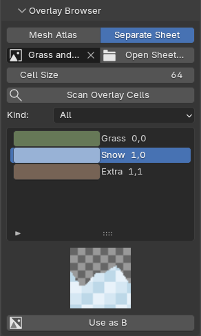

# Sprotile guide

Open the **Sprotile** tab in the 3D Viewport sidebar with **N**. Most workflows start with a mesh in Edit Mode. Use **Material Preview** to see textures and blends.

## Map or paint a tile

1. In Face Select, select the faces you want to texture. If they need an atlas, choose **Map Tiles > Set Up Atlas…** and open an image. Existing atlas materials can be used directly.
2. Set **Tile Size** to the side of a full tile in pixels. Choose **Full Tile**, **Half Tile - Wide**, or **Half Tile - Tall** to match the atlas grid.
3. Open the picker and click a tile to select it. **Map Per Face** repeats the whole tile on each selected face. **Map as Patch** spans the selection with one tile.
4. For brush painting, press **T** to show the toolbar and choose **Sprotile Paint** in Edit Mode. Drag over the visible mesh. **[** and **]** change the brush radius. Each stroke is one Undo step. The brush paints per face and replaces blends on the faces it paints.

| Picker control | Action |
| --- | --- |
| Click | Select a tile |
| Ctrl-click or double-click | Map it immediately using **Picker Click and 4 Key** |
| **4** over the viewport | Map the current tile using the same setting |
| Wheel, middle or right drag | Zoom around the pointer, or pan by dragging |
| **Home** or **Fit Atlas** | Fit the atlas in the picker |
| **Focus Tile** | Centre and enlarge the current tile |
| **R** / **Shift+R**, **X**, **Y** | Turn the next tile or flip it horizontally or vertically |
| **A** / **B** over a tile | Capture that tile for a blend |
| **Esc** over the picker | Close it |

Drag the right edge to resize the picker. Drag blank space inside it to move it horizontally. **Recently-used Tiles** recalls picks from the current atlas. **Pipette** or **Alt+P** samples the active selected face. For a placed regular tile, select its face and use **Alt+R** or **Alt+Shift+R** to turn it.

## Fit one tile across a patch

Select the patch faces and choose a **Patch Method** before clicking **Map as Patch**.

- **Surface (Planar)** projects onto the patch's average plane. Use it for walls and signs.
- **View (Planar)** projects from the current viewport. Face the surface you want to map.
- **Unfold (Bent)** follows the surface through bends and uses marked UV seams as cuts.
- **Existing UVs** fits the current layout to a new tile while keeping its arrangement and orientation.

Under **Patch Fit**, choose how the projected outline fills the tile. If adjacent tiles bleed onto the face, try a small **UV Inset** under **Mapping Options**. If UVs move but the visible texture stays the same, check which UV map the material reads.

## Blend two tiles

1. Under **Texture Blend**, choose **Fade between two tiles** in **Quick start**. Choose the first tile in the picker and click **Capture A**, then choose the second and click **Capture B**.
2. Select the target faces and click **Apply Blend**. Use **Feather** to set how much of the patch the transition covers.
3. Select a blended face and switch to **Edit Blend** to adjust that placed blend. Use **Copy Blend** to bring its settings into **New Blend** for another selection.

**Grass or snow edge** shapes the transition. **Path** makes a band of B with A along both sides of a selected patch. **Paint B by hand** uses Vertex Paint to reveal B inside a selected area. Capture B, select the faces, and choose **Paint B on Selected Faces**, then use **Show B** and **Hide B** while painting.

## Paint paths and blend seams

- **Path brush** works on already tiled ground. In **Quick start**, choose **Path brush**, capture the path tile as B, and click **Path Brush** in Edit Mode. Drag to lay B over faces and blend neighbouring faces into it. **Ctrl-drag** erases. **[** and **]** resize the brush, and **Enter**, **Esc**, or right-click finishes the tool. **Ctrl+Z** undoes a stroke.
- **Blend a seam** uses the tiles already placed on both sides. Select the edges where they meet, or select the faces on both sides, then click **Blend This Seam**. Choose which side changes with **Sides** and adjust how far the fade reaches with **Feather**.

## Layer an overlay

1. Under **Texture Blend > Quick start**, choose **Overlay cell**. Capture the base tile as **A**.
2. Open **Overlay Browser** and choose a source. **Mesh Atlas** uses the captured A image, or the active face's atlas if A is empty. Its cell size is **Tile Size** in Map Tiles. For a second image, choose **Separate Sheet**, select a loaded image or click **Open Sheet…**, and set **Cell Size** to the width of a square tile on that sheet. You can use 16 px decals on a 64 px mesh atlas.
3. Click **Scan Overlay Cells**. The list contains whole cells with both clear and solid pixels. Choose a **Kind** to filter the list, select a row and inspect its checkerboard preview. **Use as B** captures that cell. Opening the sheet or selecting a row keeps the previous B available until you make that choice.
4. Select the destination faces and click **Apply Blend**. Adjust **Opacity** to control how strongly B shows over A. With a shared material, different cells from one sheet use one overlay texture slot in Unreal.

For a single cutout that fills a PNG, choose **Open PNG as B**. **Soften B** generates a soft edge from a captured tile. For artwork with a pure black background, the PNG file selector also offers **Pure black key**.

Scan again after editing or reloading the sheet. On large images, a fresh scan also restores cell previews after reopening a file. Pack external images into the Blender file or keep their paths available when moving the project.

## Export blends to Unreal

1. Open **Sprotile > Unreal Export** and select the meshes you want to export. Use **Prepare UVs for Unreal** if the report asks you to reorder the maps. It puts the render map (including A), B, Factor, and optional Edge in UV channels 0–3.
2. Export with Blender's FBX exporter. For Paint B, export vertex colours with **Tint** active.
3. In Unreal, turn off generated lightmap UVs or set their destination to an unused channel at index 4 or higher. Use a material built around Sprotile's blend decoder and copy the reported material settings and overlay slots from Blender's panel. [Unreal Custom node HLSL](unreal/SprotileBlend.hlsl)
